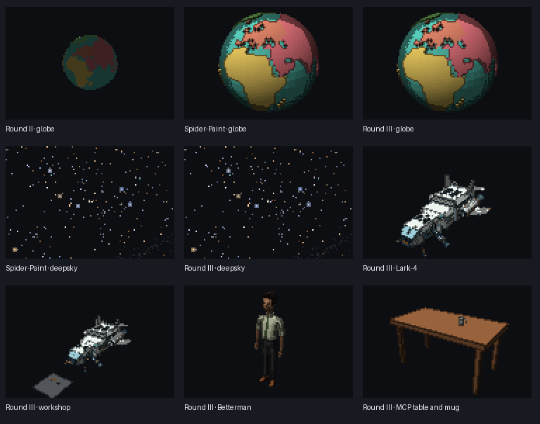

# Black Hole Benchmark — Round III

Native version 26.11.27005. Reference [Spider-Paint 26.11.26003](https://github.com/Pengeszikra/Spider-Paint/tree/6f29a123f92e50aaa044d0f6c272b387ad0e697f). The comparison uses the original terminal rasterizer. The original interactive terminal also has a browser-backed renderer with additional effects. The Rust program runs independently.

## What changed on screen

The images decode the RGB foreground and background of every ANSI cell, in order, before integer nearest-neighbour enlargement. At 120 × 40 cells the viewport contains 9,600 half-pixels. The globe covered 1,185 half-pixels in Round II with mean foreground channel intensity 43.93. It now covers exactly the reference's 3,969 half-pixels, with mean intensity 88.50 versus 88.48. Five half-pixels differ in RGB; mean absolute foreground channel error is 0.042 on a 0–255 scale. All 305 occupied Deep Sky half-pixels match the reference positions. One differs in RGB. These are comparisons of the opening frames at the default camera, without a selection. They do not establish visual parity through a whole flight.

## Timings

Linux x86-64, AMD EPYC 9V74, rustc 1.100.0, release LTO, single codegen unit. A clean release build into an empty target directory took 14.42 seconds wall time. The binary was 1,283,616 bytes. The Rust sources in src/ plus build.rs contained 6,910 lines and 235,989 bytes, including unit tests. Models, documentation, tool schemas and the Python test harness are excluded. A process printing the version took 1.16 ms median over 15 launches.

Each engine trial rotates the actual loaded scene 0.5° per frame for 240 frames at 120 × 80 raster pixels. The timer encloses projection, lighting and rasterization. ANSI time includes change detection and escape generation. PTY throughput includes process launch, load, raster, ANSI, writes, reader drain, checksum and target timing. It is one unpaced run per row. Load, first-frame process wall time and engine/encoding rates are independent trials (five-run medians); host scheduling and file caching affect them. RSS is the PTY child's peak resident memory. The first-frame process emits a complete frame to a sink. Target order is computed once, then the next-target action is timed across 1,000 calls.

| Scene | Load ms | First frame process ms | Peak MiB | Engine FPS | ANSI ms/frame | PTY FPS | Bytes/frame | Target sort µs | Warm switch µs |
|---|---:|---:|---:|---:|---:|---:|---:|---:|---:|
| globe | 80.68 | 35.99 | 25.9 | 420.7 | 0.115 | 333.0 | 30,068 | 22.6 | 0.077 |
| deepsky | 64.09 | 58.47 | 36.4 | 1,639.9 | 0.058 | 708.2 | 11,851 | 273.6 | 0.164 |
| lark-4 | 12.07 | 20.91 | 11.4 | 444.0 | 0.065 | 390.2 | 13,682 | 58.1 | 0.178 |
| workshop | 12.09 | 19.08 | 11.5 | 518.3 | 0.050 | 470.1 | 8,869 | 57.8 | 0.162 |
| betterman | 1.70 | 3.70 | 11.9 | 5,235.7 | 0.034 | 3,315.7 | 4,888 | 14.2 | 0.072 |
| table | 0.70 | 5.07 | 12.7 | 6,949.3 | 0.031 | 4,429.3 | 4,121 | 16.1 | 0.088 |

The interactive globe emitted 52.81 synchronized frame updates per second during a two-second orbit. On 20 stationary starts the elapsed time from sending D to receiving the first bytes of feedback was 2.64 ms median and 2.94 ms p95. One second after stopping produced zero bytes. These figures include polling and PTY delivery; a physical display refresh and key-to-photon latency were unmeasured. As a separate terminal-consumer measurement, native libvterm 0.3.3 replayed the same 240-frame updates into a 120 × 42 cell grid with damage flushed after every frame: globe 5,885 FPS, deepsky 14,088, Lark 11,977, workshop 19,337, Betterman 34,290 and table 38,777. libvterm was used only by the measurement harness.

Raster-only reference rates on this host for the same dimensions, framing, lighting defaults and 240 yaw positions were 49.7 FPS (globe), 950.7 (deepsky), 81.9 (Lark) and 576.0 (Betterman). The opening images above quantify quality agreement on two scenes. The reference headless CLI interprets the workshop start-eye differently; it was excluded from the speed comparison. The generated table has no bundled reference counterpart.

## Functional compatibility

| Area | Native result | Evidence and remaining differences |
|---|---|---|
| Renderer | Verified on opening frames and depth tests | TrueColor half blocks, fitted perspective, axial orthographic views, cached face normals and triangulation, near-plane clipping, depth picking, changed-cell runs, resize and stationary silence. The native software renderer has no GPU material pipeline. |
| Mesh flight and targeting | Verified | A single T then D keeps orbiting at different tick rates. Space stops while retaining the target. Esc releases it. Enter pauses flight during search, Tab and Shift+Tab cycle. |
| Deep Sky | Partial | 5,149 named objects, search for Sun, target ordering, automatic approach braking, orbit arming, gravity, banking. Physical key-event tests cover press/repeat/release. Legacy byte-only terminals cannot signal release; held roll uses stepped input there. Full interstellar fly-through and reference slingshot trajectories lack a golden replay. Procedural planet surfaces, black-hole lensing and galaxy LOD are missing. |
| Documents and instances | Verified on shipped corpus | All 26 original model documents plus the MCP table survive native read/write as equal JSON values. Extension fields and one edited instance are tested separately. Palette, prototypes, instance slots and inactive scene metadata are retained. A rewritten topology can replace per-face metadata on new faces. |
| Q selection and editing | Partial | Vertex, edge and face selection, Shift-click, box and lasso, preview/cancel, axis/numeric transforms, point/edge/region extrusion, back faces, mirror/weld, bevel, fill, loop cut, sketch, saw, lathe, normals, material assignment and undo have native paths. Geometry tests check selected operations and solid connectivity; the PTY test edits and undoes the live mug. Mouse trajectories and complex non-manifold inputs lack comprehensive reference fixtures. |
| Solids and transforms | Partial | All six primitive constructors tested for closed geometry. BSP union, intersection and subtraction and a multi-edge bevel are tested on solids. Primitive creation inserts immediately; the reference floating placement workflow is missing. Object rotation is available through /r. |
| Enter commands and store | Partial | Searchable local catalogue, keyboard selection, local atomic save, import, merge and export, help, targets and rendering controls. Graphic file exports exercised through the actual binary: PNG CRC, dimensions and decompressed alpha, SVG XML and animation groups, GIF header and frame controls. PNG framing and SVG painter order can differ from Spider-Paint exports. No cloud catalogue. |
| Help and Markdown | Partial | All twelve original pages are included verbatim. Standalone Markdown/JSON, tables, inline formatting, fenced code, language colouring, wrapping and navigation have tests. Nested HTML/JS/CSS/JSDoc syntax regions, complex grapheme widths and exact reference typography remain incomplete. |
| Materials | Partial | Interactive swatches, keyboard navigation, property adjustments and face assignment. Data round-trips, while metal, roughness and transparency lack the original renderer's complete optical treatment. |
| MCP protocol / live workshop | Verified with two independent STDIO clients and a PTY editor | Start empty, create a five-part table, add a hollow mug and handle, see each update without reload, edit the mug in Q, observe it from the second client, undo. A stale revision is rejected. Incomplete JSON retains the last valid scene. Target identity and view preservation are tested. |
| GitHub Copilot CLI | Configuration verified, authenticated agent unverified | Copilot CLI 1.0.117 resolved the project MCP server via its own mcp get command. A real prompt stopped because the host had no Copilot authentication. |
| Platforms | Linux exercised; Apple ARM64 cross-checked | Linux PTY, native release and CLI workflows exercised here. macOS ARM64 type-check performed; M1/Ghostty performance and trackpad feel are unmeasured. |
| Other reference subsystems | Missing | Story record/play/seek, character creation and posing, 3D text placement, ground vehicle handling and the complete set of reference commands. |

## Reproduce

~~~sh
cargo fmt --check
cargo check
cargo clippy
cargo test
cargo build --release
cargo tree
python3 tests/measure.py
./target/release/spi3derr --scene deepsky --cols 120 --rows 40 --bench 240
./target/release/spi3derr --scene globe --cols 120 --rows 40 --once
~~~

Cargo test runs the unit suite and invokes a Python-standard-library PTY/MCP integration test. The application itself uses no Python or external crates. Use the same terminal size, starting camera and scene for comparisons. The figure uses the reference command bin/spider-term.mjs with --once, --cols 120 and --rows 40. To identify the source used by a build, run spi3derr --version from that build.
